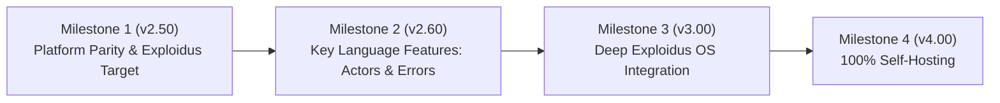

# Yolish Engineering Milestones & Cross-Platform Roadmap

> **Author**: Rahad Bhuiya & Antigravity  
> **Repository**: https://github.com/rahadbhuiya/Yolish  
> **Status**: Active Master Plan (v2.47 -> v4.00)

---

## 1. Vision & Architecture Pillars

Yolish is engineered around three foundational pillars:

1. **A Standout Modern General-Purpose Language**:
   Combines the readability of Python with native compilation, replacing Go's repetitive `if err != nil` with ergonomic guard expressions, and replacing JavaScript/Rust's "colored functions" async/await complexity with clean, lock-free actor/channel concurrency.
2. **The Flagship Language of Exploidus OS**:
   First-class language syntax for OS capability security (`cap.open`, `cap.read`) and scheduler-wired intent annotations (`@intent`), acting as the primary system scripting and application language of Exploidus.
3. **100% Self-Hosted**:
   Transitioning from the initial C bootstrap implementation to a fully self-hosted compiler written entirely in Yolish.

---

## 2. Current State & Platform Parity Audit (v2.47)

Yolish features three execution tiers:
- **Tier A (AST Interpreter)**: Portable, instant execution, REPL.
- **Tier B (Bytecode VM - `ys vm`)**: 40x faster stack VM with deep language coverage.
- **Tier C (Native Compiler - `ys -c`)**: Direct x86-64 machine code generation with zero libc dependency.

### Cross-Platform & Execution Matrix

| Capability / Feature | Linux | Windows | macOS | Exploidus OS |
|---|:---:|:---:|:---:|:---:|
| **Core Syntax & Control Flow** (vars, loops, fn) | Supported (All Tiers) | Supported (All Tiers) | Supported (All Tiers) | Legacy Interpreter |
| **Data Structures** (arrays, structs, enums, maps) | Supported (All Tiers) | Supported (All Tiers) | Supported (All Tiers) | Partial |
| **Closures & Scope** | Supported (Tier A/B) | Supported (Tier A/B) | Supported (Tier A/B) | Partial |
| **Match & Pattern Guards** | Supported (Tier A/B) | Supported (Tier A/B) | Supported (Tier A/B) | Partial |
| **File I/O (`y.fs.*`)** | Supported (All Tiers) | Supported (All Tiers) | Supported (All Tiers) | VFS direct |
| **JSON & Formatting (`y.json`, `y.fmt`)** | Supported (Tier A/B) | Supported (Tier A/B) | Supported (Tier A/B) | Missing |
| **TCP/UDP Client & Server (`y.net.*`)** | Supported (All Tiers) | Supported (Tier A/B, Winsock) | Supported (Tier A/B) | Kernel e1000 |
| **Native Compiler Networking** | Raw Syscalls | Missing IAT (ws2_32) | Missing Mach-O sockets | Missing Target |
| **Native Compiler Backend** | elf_out.c | pe_out.c | macho_out.c | Missing (--target exploidus) |
| **Capability Security (`cap.*`)** | Simulated | Simulated | Simulated | Kernel BLAKE3 |
| **Scheduler Intents (`@intent`)** | Simulated | Simulated | Simulated | Kernel Scheduler |

---

## 3. The 4 Grand Milestones



---

### Milestone 1: Platform Parity & Exploidus Target (v2.50)
*Goal: Ensure Yolish runs everywhere with full parity, and add Exploidus as a Tier-1 compilation target.*

- [ ] **Native Exploidus Target (`--target exploidus`)**:
  - Add `TARGET_EXPLOIDUS` to `compiler.c`.
  - Emit static PIE ELF binaries compatible with Exploidus `pie.ld` and ASLR loader.
  - Wire Exploidus kernel syscalls: `SYS_WRITE (1)`, `SYS_EXIT (2)`, `SYS_READ (3)`, `SYS_OPEN (4)`, `SYS_CLOSE (5)`, `SYS_CAP_CREATE (10)`, etc.
- [ ] **Windows Native Networking in `pe_out.c`**:
  - Add `ws2_32.dll` import directory entries (`WSAStartup`, `socket`, `connect`, `send`, `recv`, `closesocket`).
  - Wire native networking codegen for Windows PE.
- [ ] **Sync Yolish Engine into `Exploidus/userspace/yolish`**:
  - Replace the legacy interpreter inside Exploidus with the unified Yolish v2.47+ engine.
  - Build `ys.elf` with the standard build system so Exploidus shell can run any Yolish script.

---

### Milestone 2: Key Language Features (v2.60)
*Goal: Introduce unique features that solve the hardest pain points of other languages.*

- [ ] **Lock-Free Concurrency: Actors & Channels (`spawn` & `chan`)**:
  - No `async/await` colored functions.
  - No mutex locks or race condition headaches.
  ```yolish
  let ch = chan.new()
  spawn {
      let data = fetch_remote()
      ch.send(data)
  }
  let result = ch.recv()
  ```
- [ ] **Ergonomic Safe Guarding (`val or fallback`)**:
  - Eliminates verbose error boilerplate and null checks.
  ```yolish
  let port = y.env.get("PORT") or 8080
  let file = y.fs.read("app.conf") or return "Default Configuration"
  ```
- [ ] **Built-in High-Performance Micro HTTP Engine (`y.http`)**:
  - Write complete web microservices in a single file without external dependencies:
  ```yolish
  y.http.serve(8080, fn(req) {
      return y.http.json({ status: "ok", user: "star" })
  })
  ```
- [ ] **Raw Byte Buffer Type (`y.bytes`)**:
  - High-performance binary operations needed for network protocols, cryptography, and compiler self-hosting.

---

### Milestone 3: Deep Exploidus OS Kernel Integration (v3.00)
*Goal: Yolish becomes the native heart of Exploidus OS.*

- [ ] **Kernel-Enforced Capability Primitives**:
  - Synchronize `cap.create`, `cap.check`, `cap.revoke`, `cap.delegate` directly with Exploidus kernel capability tokens (BLAKE3).
  - Scripts cannot access hardware, network sockets, or root files unless explicitly granted capabilities by the caller.
- [ ] **Intent-Aware Scheduling**:
  - `@intent(interactive)` -> Kernel sets task to high-priority UI interactive queue.
  - `@intent(crypto)` -> Kernel assigns dedicated compute slices.
  - `@intent(batch)` -> Low priority background execution.
- [ ] **Yolish Shell Scripts (`.y`) as First-Class Executables**:
  - Kernel and shell recognize `#!/bin/ys` and execute `.y` files directly.
  - System daemons (`auditd`, `httpd`, `init`) can be authored in Yolish.

---

### Milestone 4: 100% Self-Hosting (v4.00)
*Goal: Yolish compiles Yolish without requiring GCC or Clang.*

```
Stage 0 (Bootstrap):  C-based `ys` compiler
Stage 1:              `ys (C)` compiles `compiler.y` -> `ys_stage1 (Native)`
Stage 2:              `ys_stage1` compiles `compiler.y` -> `ys_stage2 (Native)`
Verification:         `diff ys_stage1 ys_stage2` == 0 (Bit-for-bit identical)
```

- [ ] **Phase 4.1: Self-Hosted Lexer (`bootstrap/lexer.y`)**:
  - Written 100% in Yolish.
  - Tokenizes all Yolish source files and produces identical token streams to `lexer.c`.
- [ ] **Phase 4.2: Self-Hosted Parser (`bootstrap/parser.y`)**:
  - Recursive descent parser written in Yolish building AST node structs.
- [ ] **Phase 4.3: Self-Hosted Machine Code Generator (`bootstrap/codegen.y`)**:
  - Emits x86-64 machine code bytes into `y.bytes`.
  - Binary writers for ELF (Linux/Exploidus), PE (Windows), and Mach-O (macOS).
- [ ] **Phase 4.4: The Triple Bootstrap Test**:
  - Continuous integration compiles Yolish with Yolish and verifies bitwise equality.
